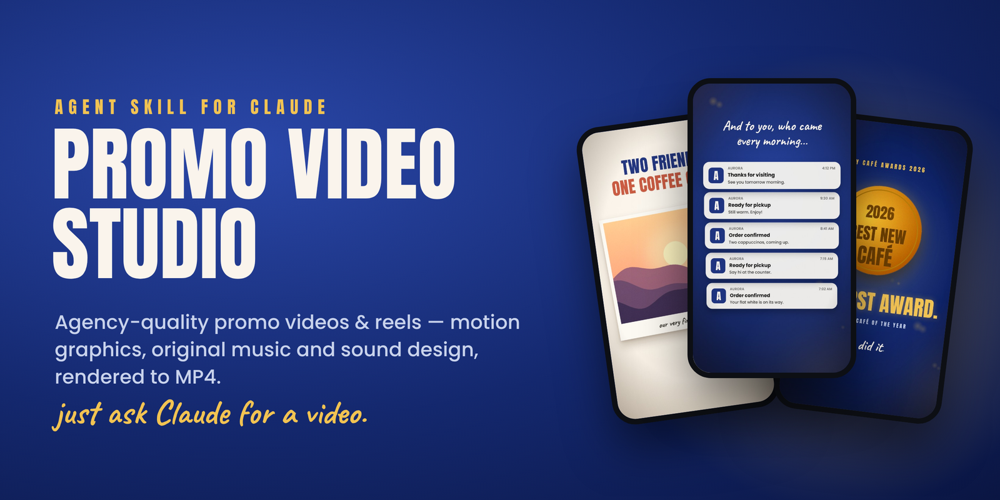
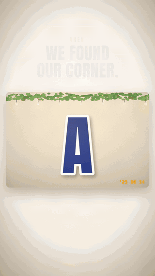
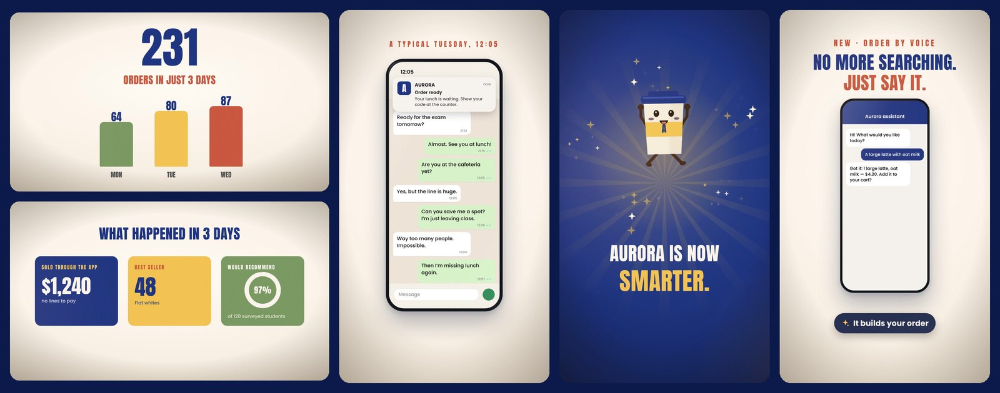

<p align="center">
  
</p>

<p align="center">
  <a href="#-install"></a>
  <a href="#-install"></a>
  <a href="#-install"></a>
  <a href="LICENSE"></a>
</p>

<p align="center"><b>Ask Claude for a video. Get an agency-quality MP4 — motion graphics, original music and sound design included.</b><br>
<a href="#-español">Leer en español ↓</a></p>

---

## ✨ What it makes

<p align="center">
  
  <br><sub><i>Made from a single prompt — <a href="examples/thank-you-reel">example source</a> · fictional brand · <a href="docs/media/demo.mp4">full video with sound (MP4)</a></i></sub>
</p>

**Promo Video Studio** turns Claude into a senior motion designer, editor and composer. It plans the story on a musical beat grid, builds every scene as animated HTML, renders it frame-by-frame with headless Chromium and scores it with **original, royalty-free music** that hits every cut.

- 🚀 **Starts from zero** — no logo, no colors, no mascot? It asks five quick questions, builds a brand kit (palette, wordmark, app icon) and, if you want one, an original rigged mascot. It **never invents facts**: names, features, prices and numbers come from you, and final renders are blocked while any placeholder is left
- 🧰 **Adapts to what you have** — full brand guide, just a logo, photos, screen recordings, a mascot, real numbers… or nothing. Every element is optional: no mascot, no voice, no music if you don't want them
- 🎬 **Signature transitions** — fly *through* a letter of your logo into the brand reveal (portal), polaroid drops, handwriting reveals, light leaks and film grain
- 🏆 **Hero moments** — cut out an award, medal or product from a phone photo and light it with a golden sweep
- 📱 **App & product promos** — phone mockups playing real screen recordings (auto-cropped, clean status bar, private data blurred), iOS-style notifications, chat conversations
- 🎙️ **Voice-over with ElevenLabs** — script → voice with word timestamps → each phrase placed on its scene → synced captions → music ducks under the voice. No API key? Send any recording and it syncs the captions to your script
- 🧸 **Animated mascots** — splits your mascot into body + arms + legs (automatically, or from layers for any style of mascot) and animates it: wave, point, celebrate, walk in/out, jump, peek, bow, think… It can also **talk and blink**. Exports transparent WebM/WebP for your app's splash and logout screens
- 🎵 **Music & sound design** — original, royalty-free scores in 4 styles from a cue sheet, never shrill, plus SFX (pencil, paper drops, dings, risers, booms, UI sounds) — or an SFX-only track for a licensed song
- 🔔 **Brand sounds** — a family of notification, success, tap and send/receive sounds plus a **sonic logo**, all in one key
- 📊 **Real-data scenes** — count-ups, bar charts, donut rings and stat tiles for presentation closings
- 🗂️ **Every video type** — thank-you & award reels, launch promos, new-version videos, teasers, store-launch announcements, tutorials, presentation openers, data recaps, booth loops, TikTok/Reels shorts, translations
- 🖼️ **Everything around it** — covers, LinkedIn team banners, post captions, GIFs
- 📐 **Every format** — 1080×1920 reels/TikTok/Shorts, 1920×1080 LinkedIn/YouTube, 1080×1350 feed, square
- ✅ **Built-in QA** — a machine check that installs what's missing (`doctor.py`), contact sheets before rendering, a final checklist, and a list of mistakes it will not repeat

<p align="center"><br>
<sub><i>Frames from the examples: chat opener · data recap · new-version video with mascot and captions (fictional brand)</i></sub></p>

<p align="center"><br>
<sub><i>One PNG in → body, arms and legs separated → waving, pointing, celebrating</i></sub></p>

## 🚀 Install

<table>
<tr><td><b>Claude Code</b><br><sub>terminal · desktop · IDE</sub></td><td>

```text
/plugin marketplace add JVilchezz/promo-video-studio
/plugin install promo-video-studio@promo-video-studio
```
or in one command (Claude Code ≥ 2.1.275): `/plugin install promo-video-studio --marketplace JVilchezz/promo-video-studio`<br>or from your shell: `claude plugin marketplace add JVilchezz/promo-video-studio && claude plugin install promo-video-studio@promo-video-studio`
</td></tr>
<tr><td><b>Claude.ai</b><br><sub>web · desktop · mobile</sub></td><td>

1. Download **`promo-video-studio.zip`** from [Releases](../../releases/latest)
2. **Customize → Skills → + → Create skill → Upload a skill**
3. Make sure **Settings → Capabilities → Create and edit files** is on

Or paste this repo's link in a chat and ask: *"Install this skill for me"* — if your Claude can save skills, it shows you a card to save it in one click.
</td></tr>
<tr><td><b>Any agent</b><br><sub>Claude Code, Cursor, Codex…</sub></td><td>

```bash
npx skills add JVilchezz/promo-video-studio
```
</td></tr>
<tr><td><b>Manual</b></td><td>

Copy `plugins/promo-video-studio/skills/promo-video-studio/` into `~/.claude/skills/` (personal) or `.claude/skills/` (project).
</td></tr>
</table>

**Requirements** (Claude installs them when missing): Python 3.10+, `playwright` + Chromium, `numpy`, `scipy`, `pillow`, `opencv-python-headless`, and `ffmpeg`.

## 💬 Try it

> Make a 45-second Instagram reel thanking our customers for our first year. Here are 6 photos, our logo and the award we won. Make it emotional but exciting.

> Create a 60-second horizontal LinkedIn video launching our app. Use these screen recordings. No voice-over, professional.

> Turn this into a 20-second TikTok ad with a strong hook. Faster pacing, uplifting music.

> I have a small bakery called Luna and nothing else — no logo, no colors. Make me a 20-second Instagram reel.

> We launched version 2.0 with voice ordering. Make a 30-second reel with a voice-over (here's my ElevenLabs key and voice ID), captions, and our mascot celebrating.

> Here's our mascot PNG. Separate its arms and legs, make it wave, and export it as a transparent animation for our app's splash screen.

> Make an opening for our presentation: a chat about the long line at the cafeteria, then our app's notification. And a closing with our real numbers from this week.

> Create a notification sound and a sonic logo for our app. Give me 4 options.

> The music sounds too sad — make it more exciting. And speed the whole video up a bit.

## ⚙️ How it works

```text
brief ─► storyboard on a beat grid ─► video.html (scenes + motion.js) ─► contact-sheet preview ─► fixes
   │   assets: photos · cutout.py · make_mask.py · recording.py · rig.py / mascot_talk.py
   ├► script ─► voice.py (ElevenLabs + word times) ─► phrases on the timeline ─► captions
   └► cue.json ─► score.py (music + SFX + UI sounds + voice ducking) ──────────────┐
          render.py (Playwright → ffmpeg) ─► silent.mp4 ──────────────────────────┴► mux ─► QC ─► final.mp4 + cover
```

| Path | What's inside |
|---|---|
| `…/skills/promo-video-studio/SKILL.md` | workflow, quality bar, toolbox, signature effects |
| `…/reference/` | client brief · video types · design · motion API & recipes · music · voice-over · mascots · sound · deliverables · QA |
| `…/lib/` | `motion.js` (deterministic animation kit: scenes, portal, captions, chat, charts, rays, icons…) · `base.css` |
| `…/scripts/` | `doctor.py` · `brand.py` · `new_project.py` · `render.py` · `score.py` · `mux.py` · `voice.py` · `recording.py` · `rig.py` · `mascot_make.py` · `mascot_talk.py` · `sfx_pack.py` · `make_mask.py` · `cutout.py` |
| `…/templates/` | vertical / horizontal pages · cue sheet · LinkedIn banner |
| `examples/` | five editable examples + `build.sh` |

## 🎞️ Examples

| | |
|---|---|
| [`thank-you-reel`](examples/thank-you-reel) | 56 s vertical: handwriting hook → polaroids → portal through the logo letter → memories → notification stack + heart → award reveal → thanks → CTA |
| [`chat-story`](examples/chat-story) | 16 s presentation opener: a chat about the long line, typing dots, the app's notification, logo — with send/receive/notification sounds |
| [`data-recap`](examples/data-recap) | 28 s horizontal closing: mascot, count-up with bar chart, stat tiles + donut, "the very first order", logo |
| [`feature-update`](examples/feature-update) | 26 s vertical: "NEW VERSION 2.0", mascot glory moment with rays and sparkles, phone demo with captions, store badges |
| [`mascot`](examples/mascot) | a fictional mascot split into parts with `rig.py` — the source of every mascot animation above |

Render them yourself (needs Python, Playwright and ffmpeg):
```bash
bash examples/build.sh                 # all examples
bash examples/build.sh chat-story      # just one
```

## 🤝 Contributing

Ideas, new effects, new music styles and example videos are welcome — open an issue or a PR.
If this skill made you a video you love, **⭐ star the repo** and share it with `#PromoVideoStudio`.

## 📄 License

MIT © José Vílchez · Fonts (Anton, Poppins, Caveat) under the SIL Open Font License 1.1 · Generated music is original and free to use commercially.

---

## 🇪🇸 Español

**Pedile un video a Claude y recibí un MP4 con calidad de agencia**, con motion graphics, música original y efectos de sonido.

**Instalación**
- **Claude Code:** `/plugin marketplace add JVilchezz/promo-video-studio` y después `/plugin install promo-video-studio@promo-video-studio`
- **Claude en el navegador o la app:** descargá `promo-video-studio.zip` de [Releases](../../releases/latest) y andá a **Customize → Skills → + → Create skill → Upload a skill**. Tené activado **"Create and edit files"**. También podés pegarle el link de este repo a Claude y pedirle *"instalame esta skill"*.
- **Cualquier agente:** `npx skills add JVilchezz/promo-video-studio`

**Sirve para cualquier empresa, aunque empiece de cero:** si no tenés logo ni colores te hace 5 preguntas rápidas, arma el kit de marca y, si querés, una mascota original lista para animar. **Nunca inventa datos**: nombres, funciones, precios y cifras salen de vos. Todo es opcional (mascota, voz, música).

**Qué hace:** planifica la historia sobre el ritmo de la música y anima cada escena con transiciones como el portal a través de la letra del logo, polaroids, escritura a mano, notificaciones, chats, cifras que suben, gráficos y el brillo dorado para premios y productos. Pone **voz con ElevenLabs** (o con cualquier grabación tuya) con subtítulos sincronizados, **separa las partes de tu mascota y la anima** (saluda, señala, celebra, camina, habla y parpadea), compone **música original** sin derechos de autor en 4 estilos, crea **sonidos de notificación y un logo sonoro** para tu app, y hace todo lo de alrededor: portadas, banners de LinkedIn y el texto del post. Sabe hacer reels de agradecimiento, lanzamientos, nuevas versiones, teasers, tutoriales, aperturas y cierres de presentaciones, loops para stands y videos para TikTok. Antes de entregar revisa cada detalle.

**Probalo:**
- *"Haceme un reel de 45 segundos para Instagram agradeciendo a nuestros clientes por el primer año. Acá van las fotos, el logo y el premio. Que sea emotivo pero emocionante."*
- *"Sacamos la versión 2.0. Haceme un video con voz de ElevenLabs, subtítulos y la mascota celebrando."*
- *"Acá está la mascota en PNG: separale los brazos y las piernas y hacé que salude."*
